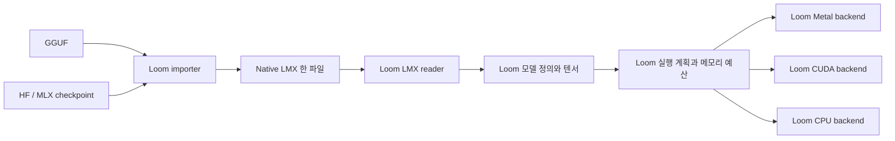

# LMX — Loom 전용 모델 파일과 실행 계약

2026-10-09 목표 재정의. Native v2의 schema·reader/writer·Qwen MLX importer와 expert 슬롯 IO를 구현했다. [v2 binary 규격과 지원 범위](loom-lmx-v2-native.md)를 따른다. **native 생성 runtime과 GPU paging 연결은 아직 미구현이다.** 현재 `lmx.rs`의 v1은 GGUF 또는 MLX 체크포인트를 감싸는 컨테이너다. [v1 구현과 실험 기록](loom-lmx-v1-container.md)은 별도로 보존한다.

## 목표

**LMX는 Loom 전용 엔진이 직접 읽고 실행하는 독립 모델 포맷이다.** 파일 하나가 모델의 구조, 가중치 표현, tokenizer, chat template과 실행에 필요한 의미를 완결해서 담는다. GGUF와 MLX 체크포인트는 가져오기 단계의 입력이며, 실행할 때 다시 열거나 그 포맷의 모델 로더에 넘기는 대상이 아니다.

사용자는 같은 LMX를 Apple·Windows·Linux에 가져간다. Loom은 파일의 같은 모델 정의와 가중치를 읽고 **Metal → CUDA → CPU** 순서로 지원되고 실행 가능한 자체 backend를 선택한다. 메모리 우선은 선택한 장치에서 가중치·KV·작업 버퍼를 예산 안에 넣는 기준이다. GPU를 사용할 수 있는데 CPU부터 고르는 정책을 뜻하지 않는다.

LMX의 첫 제품 목적은 **도구 사용 LoRA를 적용할 수 있는 로컬 모델**이다. base weight는 유지하고 어댑터는 분리한다. 가중치 tensor의 HF 정식 이름과 의미를 유지해 학습 결과를 연결한다.

## 책임 경계

| 계층 | 소유하는 내용 | 외부 포맷과의 관계 |
| --- | --- | --- |
| Importer | 원본 해석, 이름·축 정규화, 양자화 재배치, 검증, 원자적 게시 | GGUF/safetensors/config/tokenizer 해석은 여기서 끝낸다 |
| LMX reader | 버전·범위·해시 검증, 모델 정의와 tensor view 구성 | 원본 parser나 원본 모델 loader를 호출하지 않는다 |
| Loom engine | attention·RoPE·MLP·MoE, tokenizer/template, LoRA, KV·세션 | LMX가 정의한 모델을 실행한다 |
| Device backend | 해당 연산·양자화의 Metal/CUDA/CPU 커널, 버퍼 배치 | 모델 종류를 다른 엔진에 위임하지 않는다 |

MLX tensor primitive, Metal API, CUDA/cuBLAS, CPU BLAS 같은 연산 라이브러리는 사용할 수 있다. **모델 구조·가중치 의미·실행 계획·세션을 Loom이 소유하는 것**이 전용 엔진의 기준이다. `llama.cpp`에 모델을 로딩하고 추론을 넘기는 것은 그 기준을 충족하지 않는다. llama.cpp와 기존 MLX 모델 로더는 변환/출력 검증용 개발 도구로만 남길 수 있다.

## Native LMX 파일 계약

기존 v1과 구분되는 새 버전(native LMX v2)을 사용한다. 기존 파일을 새 규격이라고 이름만 바꾸지 않는다. 128-byte header와 16 KiB block 정렬, bounded JSON index를 [binary 규격](loom-lmx-v2-native.md)에 확정했다. 다음 의미와 경계는 고정한다.

| 파일 영역 | 필수 내용 |
| --- | --- |
| Header / index | LMX magic, 규격·schema 버전, 영역 종류·범위·정렬·해시, 필요한 기능 |
| Model definition | 버전이 있는 Loom architecture recipe, hyperparameter, 연산 의미와 tensor 역할 |
| Tensor table | HF 정식 이름, 정확한 논리 rank/shape, dtype/quantization/layout, 파일 내 범위와 공유 참조 |
| Weight blocks | Loom이 규정한 dense/quantized 표현의 실제 데이터 |
| Tokenizer | 알고리즘·normalizer·pre-tokenizer·vocab·merge/score·added token·special token·BOS/EOS/EOG 정책 |
| Prompt contract | chat template과 버전이 있는 template 실행 의미, 필요한 special token 규칙 |
| Provenance | 원본 revision/hash, importer 버전, 정밀도 변경 여부와 검증 기록 |

- GGUF 파일 전체, safetensors 파일 전체, `config.json`을 payload로 넣고 그 loader를 재호출하는 구조는 native LMX로 인정하지 않는다. provenance의 원본 포맷은 실행 분기 조건이 아니다.
- 모델 정의는 `qwen2` 같은 문자열 하나를 넘기는 수준을 넘는다. attention 형태, head dimension, Q/K 정규화, RoPE 변형, activation, tied embeddings, MoE routing 등의 의미를 명시한다. 지원하지 않는 기능은 구체적으로 거부한다.
- 정확한 rank를 저장한다. `[n]`과 `[n, 1]`을 합치지 않는다. tied embedding/head는 같은 tensor storage 참조로 표현하고 weight를 복제하지 않는다.
- 모든 영역을 같은 파일의 offset/range로 읽는다. tokenizer/config/template 복원 파일, 가중치 사본, 필수 변환 캐시를 만들지 않는다. read-only 파일과 디렉터리에서도 실행돼야 한다.
- 모델 정의와 template은 검증 가능한 선언 데이터다. 임의 host code나 외부 파일 실행을 허용하는 포맷으로 만들지 않는다.
- 장치 선택, 가용 메모리, KV 정책과 배치 크기는 실행 시 계획이다. 특정 사용자의 GPU나 OS 경로를 base model의 의미에 고정하지 않는다.

## 가중치와 양자화

**기본 import는 원본의 수치 의미를 보존하는 재배치다.** 원본 파일 바이트 전체를 복사하는 것과 수치 의미 보존은 다르다. 파일 배치와 bit packing은 바꿀 수 있지만, 코드값·scale·zero point·bias의 관계를 임의로 반올림하거나 새로 양자화하지 않는다. 원본 파일은 import가 수정하지 않는다.

native 표현은 원본 라이브러리의 enum이 아니라 LMX가 규정한 수식과 packing으로 정의한다. 초기 표현은 다음을 기준으로 명세·구현한다.

| 표현 | LMX가 정의할 의미 |
| --- | --- |
| Dense | dtype(F32/F16/BF16 등), endian, 정확한 shape와 stride/layout |
| Grouped affine | packed code의 bits·signedness·순서, group size·axis, zero point, scale/bias dtype와 참조, 역양자화 수식 |
| Factored grouped | 상위 block scale과 하위 group 계수/offset을 분리한 수식과 배열. K-quant의 계층적 정밀도 보존에 사용 |

각 표현에는 schema revision을 둔다. `ggml:q4_K`나 `mlx_affine:4`라는 이름만 저장하고 외부 라이브러리의 해석에 의존하지 않는다. importer가 원본을 해석해 명세된 LMX 표현으로 쓴다. 우연히 어떤 원본과 bit layout이 같더라도 LMX reader와 커널은 LMX 명세만으로 해석할 수 있어야 한다.

- 텐서마다 bits, group size, scale dtype를 지정한다. group 16/32/64 등을 표현할 수 있어야 하며 MLX의 group 32/64 제약을 파일 규격의 제약으로 만들지 않는다.
- K-quant의 `global_scale × subgroup_coefficient`를 F16 하나로 합치면 값이 달라질 수 있다. 계수를 보존하는 표현이나 값 보존을 입증한 표현을 사용한다. dense F32를 편의상 F16으로 낮추는 것도 기본 import에 포함하지 않는다.
- 저장 dtype, activation dtype, 누산 dtype, KV dtype는 별개다. 커널 capability는 이 조합과 shape 조건을 검사한다.
- 전체 모델이나 전체 expert bank를 FP16으로 펼치지 않는다. import와 load의 scratch는 고정 크기 블록 또는 계획에 명시된 범위로 제한한다.
- 낮은 bit로 바꾸는 재양자화는 별도 명시적 작업이다. 추가 오차와 평가 결과를 기록한다. 같은 bit 수를 같은 정밀도로 간주하지 않는다.
- 한 모델을 장치마다 다른 파일로 다시 변환해야 하는 것을 기본 실행 계약으로 삼지 않는다. 필요한 일시적 device packing은 메모리 예산에 포함하고 외부 파일을 요구하지 않는다.

## 전용 실행기와 장치 선택

모든 backend는 같은 LMX model definition과 tensor descriptor를 받는다. 런타임의 기본 분기가 `Payload::Gguf` / `Payload::MlxAffine`여서는 안 된다. 분기는 operation, quantization, layout, shape와 device capability로 한다.

1. 해당 모델의 필수 연산·표현을 실행할 수 있고 메모리 계획이 성립하면 Metal을 선택한다.
2. 그렇지 않고 CUDA가 같은 조건을 충족하면 CUDA를 선택한다.
3. 그렇지 않으면 자체 CPU backend를 확인한다.
4. 자체 backend가 없거나 기능을 지원하지 않으면 정확한 미지원 사유를 반환한다. llama.cpp로 몰래 넘겨 성공 처리하지 않는다.

명시한 device는 자동 대체하지 않는다. 실행 계획은 장치, 커널 조합, 가중치/KV/작업 버퍼/재사용 캐시/runtime overhead, 메모리 부족 또는 미지원의 근거를 보여준다. GPU 존재만으로 모델 지원이나 실행 가능 메모리를 추정하지 않는다.

MLX를 Apple backend의 primitive로 쓸 수 있지만, MLX 체크포인트의 config나 safetensors loader를 실행 입력으로 요구하지 않는다. q6_K 유래의 group 16 표현에 필요한 직접 Metal 커널은 별도 구현해야 한다. CUDA와 CPU도 같은 LMX 수식을 구현한다.

## Tokenizer와 LoRA

Tokenizer는 실행 계약의 일부다. LMX 안의 vocab을 얻으려고 llama.cpp의 vocab-only 모델을 로드하는 것도 native 경로에서는 제거한다. 지원하는 tokenizer algorithm과 전처리·후처리·special token 규칙을 LMX에 명시하고, Loom이 파일 안의 데이터만으로 encode/decode한다. 독립 tokenizer 라이브러리는 사용 가능하다. unsupported tokenizer를 비슷한 방식으로 흉내 내지 않는다.

Base의 tensor 이름은 HF 정식 이름을 유지하고, 실행 역할은 별도 descriptor로 연결한다. 어댑터는 base와 분리한 artifact이며 base의 identity, 대상 HF 이름, rank·scale·dtype를 명시한다. 적용을 위해 base를 다시 양자화하거나 합쳐 저장하지 않는다. 어댑터를 선택하지 않은 base LMX는 혼자 실행 가능해야 한다.

Base identity는 모델 의미·가중치·tokenizer/template에 결부한다. 다운로드 경로나 출처 문자열만 바뀌었다고 호환 어댑터가 다른 base로 오인되지 않도록 file checksum과 base identity의 역할을 나눈다. identity의 정확한 hashing schema는 native writer 단계에서 고정한다.

## 현재 구현과의 차이

| 현재 v1 | Native LMX로 바꿀 부분 |
| --- | --- |
| GGUF/safetensors 파일을 그대로 내장 | Loom 모델 정의와 native tensor/weight 영역으로 import |
| 원본 header에서 매번 IR 파생 | 파일에 독립된 model/tensor 정의 저장 |
| 원본 포맷별 loader와 executor 분기 | 단일 LMX reader와 Loom executor, device kernel dispatch |
| CPU/CUDA 추론을 llama.cpp에 위임 | 자체 CPU/CUDA backend 구현; 미구현은 미구현으로 표시 |
| GGUF tokenizer를 vocab-only llama 모델로 로드 | LMX tokenizer 데이터와 독립 encode/decode |
| 일부 MLX metadata를 캐시 디렉터리에 복원 | 파일 안의 영역에서 직접 읽기 |
| GGUF→MLX에서 F16 scale/bias로 반올림 | native quantization 명세에 따른 정밀도 보존 |
| HF 이름 변환을 로드 중 수행 | import 때 정규화하고 native tensor table에 저장 |

기존 v1 파일은 이행 입력으로만 취급한다. 필요하면 내부 원본을 importer로 읽어 native LMX를 새로 만든다. 원본/v1을 덮어쓰지 않고 검증 뒤 게시한다. 기존 v1을 읽을 수 있다는 회귀 검사는 호환성의 증거일 뿐 native 포맷의 완성 증거가 아니다.

현재 진행한 MLX 블록 변환의 메모리 최적화와 값 비교 검사는 재사용할 수 있다. v1 컨테이너, 원본 parser 의존과 외부 엔진 라우팅을 최종 구조로 굳히지 않는다.

## 새 구현 순서와 완료 조건

이전 A/B/C/D의 완료 표시는 v1 실험 범위다. native LMX는 아래 기준으로 다시 판정한다.

| 단계 | 구현 | 완료 증거 |
| --- | --- | --- |
| 1. Native schema와 reader/writer | model/tensor/tokenizer/template 영역, 독립 검증과 identity, 버전 분리 | 원본 parser 없이 LMX만 열고 모든 실행 의미를 검사 |
| 2. 첫 importer | Qwen2/Qwen3, dense·q8_0 유래 표현부터 native 정규화 | 블록별 수치 의미·정밀도 보존, bounded scratch, 원자적 게시 |
| 3. 첫 전용 실행 | 단일 LMX reader → 자체 Metal/MLX 연산기, 독립 tokenizer | 원본·캐시 없는 환경에서 생성, greedy/tokenizer 비교, 실측 메모리 상한 |
| 4. 양자화와 어댑터 | q4_0·K-quant·group 16 직접 커널, 별도 LoRA 적용 | 양자화별 값·logits/greedy 오차, base 불변·어댑터 on/off 검증 |
| 5. 장치 확대 | 같은 native LMX의 자체 CUDA/CPU backend | 플랫폼 실기기 출력·메모리 검증, Metal→CUDA→CPU 선택과 거부 근거 |

각 단계의 첫 경로를 모든 모델·모든 양자화 지원으로 표시하지 않는다. 단계 1의 첫 recipe와 단계 2의 Qwen MLX dense/affine importer를 구현했다. GGUF importer, factored quantization, native 생성과 GPU paging은 남아 있다. v1의 자체 MLX 실험이 1~3단계를 완료한 것은 아니다.

최종 수락 검사는 다음을 모두 요구한다.

- **독립 파일:** 검증용으로 복사한 native LMX만 read-only 임시 디렉터리에 두고, 원본 모델과 캐시 경로 없이 실행한다. 외부 tokenizer/config/weight 파일 접근이나 필수 부산물이 없어야 한다.
- **독립 실행:** native runtime 빌드에서 llama.cpp와 원본 모델 loader를 제외하고 실행한다. 원본 파서는 importer/검증 도구에만 허용한다.
- **정확도:** tokenizer token ID와 decode, 역양자화 수치, logits/greedy 출력, KV 재사용/rollback, LoRA 적용을 독립 기준과 대조한다. 허용 오차는 측정·기록하고 실패를 빈 출력 검사로 통과시키지 않는다.
- **메모리:** 가중치 공유, KV, 작업 버퍼, 캐시, CPU/runtime overhead를 각각 측정하고 계획과 비교한다. 전체 FP16 확장이나 로딩 중 큰 사본의 중복이 없어야 한다.
- **장치:** 같은 파일로 실제 Metal/CUDA/CPU에서 검증한다. 구현되지 않은 backend나 kernel을 외부 엔진 폴백으로 지원한다고 표시하지 않는다.
