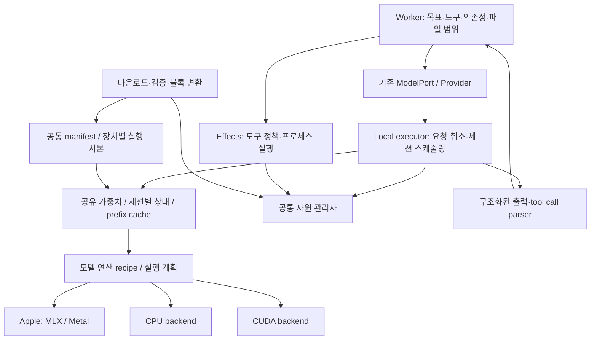

# Loom 로컬 엔진 재설계: 추론과 도구가 함께 사용하는 런타임

작성: 2026-10-09. **상태: 단계별 구현 중.** 단계 A의 process-local 자원 예약을 자체 MLX·도구 Runner·Unix PTY에 연결하고, 입장 시 유휴 버퍼/KV 회수와 실패 요청의 상태 정리를 추가했다. [구현 기록과 제한](loom-local-resource-admission.md)을 별도로 둔다. 단계 B의 첫 경로인 정밀도 보존 MLX 체크포인트 가져오기·고정 revision 다운로드·manifest 등록을 구현했다. [가져오기 범위와 검증](loom-model-import.md)을 별도로 둔다. GGUF→MLX 변환기·세션 스케줄러·추가 양자화 형식은 아직 구현되지 않았다. 기존 MLX 실측은 [기존 기록](loom-mlx-memory-moe.md)에 둔다. 이후 엔진 구조의 기준은 이 문서다.

사용자 우선순위(2026-10-09): **모델 준비와 양자화·모델 지원 확대는 필수**다. 동시 세션은 뒤로 두고, 도구 연동은 실제 가능성을 확인하며 진행한다. **이미지 입력과 다중 OS는 독립된 단계**로 관리한다. B→C→D→E→F를 진행하면서 G의 Windows/Linux·CPU/CUDA 지원을 B/C와 병행한다. 한 단계의 첫 경로 구현을 해당 단계 전체 완료로 표시하지 않는다.

2026-10-09에 [LMX 목표를 전용 모델 포맷으로 재정의](loom-lmx.md)했다. GGUF/MLX는 import 입력이며, native LMX는 Loom 모델 정의·가중치·tokenizer·template을 담고 전용 실행기가 직접 읽는다. 기존 원본 payload 컨테이너와 llama.cpp 라우팅은 [v1 실험 기록](loom-lmx-v1-container.md)으로 분리한다. Native schema/reader/writer, 독립 tokenizer와 자체 CPU/CUDA backend는 아직 구현되지 않았다. 이 문서의 기존 backend/장치별 실행 사본에 관한 항목이 새 LMX 계약과 충돌하면 새 LMX 계약을 따른다.

## 1. 목표와 판단 기준

모델을 실행하면서 코드 검색, 파일 편집, 빌드, 테스트도 수행할 수 있는 로컬 런타임을 만든다. 우선순위는 **필수 품질과 정확성을 지키면서 메모리 예산 안에 들어가는 것, 그다음 전체 작업을 빨리 끝내는 것**이다. 낮은 비트 수나 높은 tok/s 자체를 목표로 삼지 않는다.

필수 요구사항:

- 원본 가중치의 정밀도를 보존하는 import를 기본으로 제공한다. 양자화된 원본이면 원본의 양자화 표현과 수치 의미를 보존한다.
- 여러 양자화 방식과 텐서·레이어·expert별 혼합 정밀도를 일급 기능으로 제공한다. 가중치, 연산, 누산, KV 상태의 정밀도를 구분한다.
- Dense와 MoE를 지원하고, architecture recipe와 연산 구현을 확장해 모델 호환성을 넓힌다.
- Apple·Windows·Linux에서 같은 세션·자원·도구 계약을 사용한다. 물리적인 가중치 배치와 커널은 장치별로 최적화한다.
- 추론·도구·모델 변환에 공통 자원 예산을 적용하고, 독립적인 작업은 예산 안에서 겹쳐 실행한다.
- 사용자나 agent마다 모델을 복제하지 않는다. 동일 실행 프로필의 가중치는 공유하고 상태만 분리한다.

첫 구현의 범위는 기존 MLX와 도구 실행 경로를 연결하는 자원 관리다. 모든 아키텍처와 GPU 커널을 한 번에 다시 만드는 작업은 이후 단계로 나눈다. 파일 포맷 변환만으로 미지원 모델의 연산을 지원했다고 간주하지 않는다.

## 2. 현재 구조에서 바꿔야 할 경계

| 현재 연결 지점 | 관찰 | 새 구조에서의 역할 |
| --- | --- | --- |
| `loom-core/src/models/mod.rs`: `ModelPort`, `Provider`, `Request` | 동기 호출·스트리밍, 취소·timeout·tool schema 제공 | 외부 계약 유지, 내부 로컬 executor로 연결 |
| `loom-core/src/models/mlx_runtime.rs`: `LOADED` | 모델과 현재 상태를 전역 mutex로 보호하며 요청 전체를 직렬화 | 공유 가중치와 세션 상태 분리, 실행 단위별 양보 |
| `loom-core/native/mlx/engine.cpp` | 자체 dense/Qwen3 MoE, affine 혼합 bit 지원. 그룹 크기는 모델 내 동일 | Apple backend의 초기 구현과 회귀 기준 |
| `loom-core/src/models/native_runtime.rs` | 기존 llama.cpp 기반 CPU/Metal/CUDA 경로 | 호환성 경로와 비교 기준. 각 OS 실기기 검증 별도 |
| `loom-core/src/effects/runner.rs`: `run_with_policy` | 정책 설정 뒤 도구 프로세스 시작, 취소·timeout 감시 | 시작 직전 자원 예약, 종료 경로 전부에서 예약 반환 |
| `loom-core/src/worker/budget.rs`: `SharedModel` | 모델 호출·토큰·시간 예산 공유 | 기존 의미 유지, 하위 자원 예산과 함께 사용 |
| `loom-core/src/agent/orchestration.rs`, `worker/agents.rs` | 의존성과 파일 충돌을 고려한 실행 | 실행 가능한 작업에 자원 admission 추가 |
| `loom-core/src/models/checkpoints.rs`, `local.rs`, `cli.rs` | GGUF 중심 다운로드·관리 경로와 별도 CLI 경로 존재 | 무결성·취소·게시 기능 재사용, import 진입점 통합 검토 |

자원 관리는 모델과 effects가 함께 사용하는 하위 계층에 둔다. 예를 들어 `base/resources`가 공통 예약 계약을 소유하고, 모델 스케줄러와 도구 runner가 이를 사용한다. effects가 MLX나 모델 로더에 의존하도록 만들지 않는다. 실제 파일 배치는 구현 전에 기존 base 의존성 규칙과 다시 맞춘다.

## 3. 전체 구조



자체 엔진이 소유하는 것은 모델 해석, 실행 계획, 세션, 메모리, 스케줄링과 출력 계약이다. 초기 수치 연산에는 검증된 MLX·기존 backend의 primitive를 사용한다. 자체 커널은 실제 병목을 측정한 부분부터 대체한다.

모든 플랫폼에서 통일하는 것은 논리적 모델과 계약이다. Apple에 유리한 packing을 CUDA에 그대로 강요하거나, GGUF의 모든 양자화를 하나의 MLX affine 형식으로 강제 변환하지 않는다. 같은 모델의 실행 사본이라도 장치별 layout이 달라질 수 있다.

## 4. 다중 양자화: 네 가지 독립 축

| 축 | 예 | 계약 |
| --- | --- | --- |
| 저장 표현 | FP16/BF16, affine INT, GGUF block quant, GPTQ/AWQ 계열, MXFP/NVFP 계열 | scheme·bits·group·axis·packing·scale·zero point를 명시 |
| 혼합 배치 | attention 8bit, expert 4bit, router BF16 등 | 텐서별 표현 지정. 예시 조합의 품질 우위는 사전 가정하지 않음 |
| 연산 정밀도 | 압축 가중치 × BF16 activation, FP32 누산 등 | 저장 bit와 별개. backend의 실제 연산 능력 확인 |
| 세션 상태 | F16 KV, 양자화 KV, recurrent state | 모델 가중치와 별도 정책·품질 검증·캐시 식별자 사용 |

위 형식들은 **지원 목표의 분류**다. 현재 자체 MLX가 모두 지원하는 것은 아니다. 같은 4bit라도 affine, GGUF Q4 계열, GPTQ는 서로 다른 해석과 커널이 필요하다. bits 하나로 포맷을 식별하지 않는다.

### 4.1 정밀도 보존과 변환

변환 계획에 다음 두 경우를 명시한다.

1. **의미를 보존하는 재배치:** 축 변경, endian/packing 재배치, 호환 가능한 QKV 합치기, expert bank 구성. 압축 코드·scale·bias의 관계를 보존하고 논리적인 역양자화 값이 동일한지 확인한다.
2. **수치가 바뀌는 변환:** FP16→4bit, GGUF block quant→다른 affine quant, group size 변경 등. 재양자화로 표시하고 품질 기준을 적용한다. 저비트 원본을 FP16으로 풀었다고 원래 고정밀 가중치를 복원한 것으로 취급하지 않는다.

고정밀 원본이 있으면 새 저비트 사본은 원본에서 만든다. 이미 양자화된 원본만 있으면 그 사실과 추가 오차를 기록한다. 기본 import는 정밀도 보존이고, 낮은 정밀도의 실행 프로필은 사용자가 선택한 품질 정책 안에서 생성·선택한다.

### 4.2 혼합 정밀도 실행

커널 registry는 `(operation, device, scheme, bits, group, layout, activation dtype, accumulation dtype)` 조합의 지원 여부와 임시 메모리 요구를 반환한다. 실제 실행 계획에는 shape 조건도 포함한다.

- 가능한 경우 압축 상태로 직접 연산한다. 전체 모델이나 전체 expert bank의 일괄 FP16 확장을 피한다.
- 직접 커널이 없으면 한정된 블록의 복원 비용까지 예산에 넣거나, 지원되는 기존 backend를 선택한다. 둘 다 불가능하면 해당 조합을 거부한다.
- 텐서별 서로 다른 group size를 표현할 수 있게 한다. 현재 MLX의 동일 group size 제한은 capability에 드러내고 단계적으로 제거한다.
- expert별로 다른 packing은 단일 `gather_qmm` bank와 충돌할 수 있다. 같은 scheme/layout별 bank로 묶고 scatter/reduce하는 비용까지 비교한다.
- 세밀한 혼합 정밀도는 커널 호출과 작은 bank를 늘릴 수 있다. 실측 이득이 있는 묶음만 프로필로 제공한다.

### 4.3 실행 프로필과 변경 경계

프로필은 정확한 weight hash, tensor quant spec, compute/KV policy와 layout을 묶는다. `preserve`, `balanced`, `compact` 같은 이름은 사용자 설명이며 실제 내용은 manifest로 고정한다. 처음부터 가능한 모든 사본을 생성하거나 RAM에 함께 올리지 않는다.

가중치 또는 양자화 프로필이 바뀌면 이전 KV를 그대로 재사용하지 않는다. 기존 상태는 이전 가중치로 계산된 결과이기 때문이다. 기본 변경 경계는 세션 시작 또는 명시적인 재계산 지점이다. 변경 도중 구·신 가중치가 겹쳐 올라가는 메모리도 예약해야 한다.

메모리 압박은 우선 스케줄링과 캐시로 해결한다. 실행 도중 몰래 bit 수를 낮추거나 문맥을 자르지 않는다. 이미 보유한 KV를 다른 정밀도로 바꾸는 작업도 별도 상태 전환이며, 임시 메모리·오차·지원 커널을 검증해야 한다.

MLX-LM의 [변환기](https://github.com/ml-explore/mlx-lm/blob/main/mlx_lm/convert.py)는 텐서별 mixed-bit recipe의 참고 구현이다. 그 recipe를 모든 모델의 최적 배분으로 채택하지 않고, 모델별 검증을 거친다.

## 5. 다운로드와 실행 사본

```text
원본/적합한 기존 변형 탐색
  → architecture·quant·tokenizer 지원 확인
  → 다운로드/이어받기 및 전체 shard 무결성 확인
  → 자원·디스크 예산이 포함된 변환 계획
  → 블록 단위 읽기/재배치/선택적 재양자화
  → 수치·구조·실행 검증
  → 임시 디렉터리에서 실행 사본을 원자적으로 게시
```

Apple에서는 지원 가능한 GGUF를 MLX용 사본으로 준비한다. GGUF scheme을 보존하는 직접 커널이 있으면 그 경로를 사용하고, 다른 양자화로 바꿔야 하면 손실 변환임을 드러낸다. architecture나 scheme이 미지원이면 기존 GGUF backend를 쓴다. Apple이라는 이유만으로 모든 GGUF를 재양자화하지 않는다.

초기에는 **공통 manifest + 기존 safetensors/GGUF payload**를 사용한다. 먼저 새 독자 바이너리 포맷을 만드는 비용을 피한다. manifest의 필수 필드는 다음과 같다.

| 묶음 | 필수 정보 |
| --- | --- |
| 출처 | 원본 repo/revision, 각 파일 hash·길이, 원본 dtype/quant, 라이선스 |
| 모델 의미 | architecture와 recipe 버전, shapes, attention/RoPE/activation/MoE 설정, tied weights |
| 입력 의미 | tokenizer 파일 hash, special token, chat template와 tool serialization 버전 |
| 텐서 표현 | 논리 이름·shape, payload 위치·범위, quant scheme·group·axis·scales·packing·layout 버전 |
| 실행 조건 | backend capability, compute/KV 정책, 메모리 예상치와 계산 근거 |
| 변환 결과 | converter 버전·계획 hash, lossless/lossy 구분, 검증 결과·품질 fixture 버전 |

동일 원본과 동일 계획은 같은 실행 사본을 재사용한다. OS/GPU/드라이버에 종속된 컴파일 캐시는 별도로 둔다. backend 업데이트 시 재검증하며 변환 결과 hash도 확인한다.

변환 메모리는 `입력 블록 + 복원 블록 + 출력 블록 + 제한된 writer/index 버퍼`로 예산화한다. 이것은 달성해야 할 계약이며 현재 로더에 이미 보장된 특성이 아니다. 전체 텐서를 요구하는 reader/writer는 교체하거나 지원 범위를 제한해야 한다. 재시작 가능한 chunk 기록과 임시 파일 정리를 제공하고, 검증 전에 원본을 삭제하지 않는다. mmap도 실제 resident page와 파일 캐시를 사용하므로 공짜 RAM으로 계산하지 않는다.

## 6. 메모리 소유권과 세션 상태

### 6.1 공유할 것과 분리할 것

- **공유:** 같은 모델 실행 프로필의 불변 가중치, tokenizer, 실행 계획, 불변 prefix block.
- **세션별:** 토큰 이력, KV/recurrent state, RNG/sampler, tool parser 상태, 취소·기한, 어댑터 식별자.
- **작업별:** prefill/decode scratch, expert dispatch, 변환 staging, CPU/GPU 전송 버퍼.

세션을 생성할 때 가중치를 복제하지 않는다. 공통 접두사는 불변 block을 참조하고, 분기 후 수정 부분만 copy-on-write로 분리한다. 재사용 키에는 정확한 토큰 접두사, weight/quant profile, adapter, position/RoPE, KV 표현, tokenizer/template 의미를 포함한다. hash만 신뢰해 잘못된 토큰열을 결합하지 않도록 내용 식별과 검증 규칙도 고정한다.

파일 내용이 바뀌어 프롬프트 중간 토큰이 달라지면 그 지점 이후의 causal state는 다시 계산한다. 변경된 파일 구간의 KV만 갈아 끼우는 방식은 일반 transformer에서 올바르지 않다.

### 6.2 상태 관리

KV는 작은 block 단위로 소유·회수할 수 있게 하되, **block allocator와 paged attention 커널을 구분**한다. 초기 backend가 연속 KV를 요구하면 gather/복사와 임시 버퍼가 발생한다. 이 비용을 포함해 효과를 검증한 뒤 직접 block을 읽는 attention을 도입한다.

정밀도 변경 없이 회수 가능한 순서는 재사용 scratch, 참조 없는 prefix cache, 유휴 세션의 재계산 가능한 상태다. 활성 요청이 참조하는 block은 회수하지 않는다. 유휴 상태의 디스크 저장은 크기·I/O·재개 시간과 재계산 비용을 비교해 선택하며 모델·프로필 버전으로 검증한다. recurrent/hybrid 모델은 KV와 다른 snapshot 계약이 필요하다.

prefix cache는 반복 입력의 prefill 비용을 줄이는 수단이다. decode 전체를 빨라지게 한다고 가정하지 않는다. [vLLM의 prefix caching 설명](https://docs.vllm.ai/en/latest/features/automatic_prefix_caching/)도 이 구분의 참고 자료다.

## 7. 추론과 도구의 공통 자원 관리자

### 7.1 예산 영역

Apple 통합 메모리는 CPU/GPU가 같은 물리 영역을 경쟁한다. CUDA 장치는 host RAM과 VRAM 예산을 각각 관리하고 pinned/staging host 메모리도 포함한다. GPU allocator 통계와 프로세스 물리 footprint를 더해 같은 메모리를 두 번 세지 않는다.

```text
각 메모리 영역의 사용 예측 =
  공유 가중치 + live 세션 상태 + 회수 불가 cache
  + 실행 중 scratch + 전송/변환 staging
  + 도구 프로세스 예약 + 런타임 여유분

새 작업 허용 조건 =
  사용 예측 + 새 작업의 피크 증가분 ≤ 해당 영역의 가용 예산
```

가용 예산은 OS·UI·다른 앱의 여유를 확보한 값이다. 물리 메모리 전부를 엔진 한도로 삼지 않는다. 예약과 실측은 별도 장부로 관리하며, 예약한 도구의 실측 메모리를 다시 전액 더하지 않는다. 예상치를 초과하면 장부를 갱신한다. 새 작업이 절대로 들어갈 수 없는 크기라면 무한 대기시키지 않고 필요한 자원과 가능한 대안을 반환한다.

엔진이 추적하는 할당에는 상한을 적용할 수 있지만 임의의 외부 프로세스까지 같은 강도로 제한한다고 주장하지 않는다. 자식 프로세스 tree를 관찰하고 공유 page 중복에 주의한다. 플랫폼별 강제 제한을 사용할 때는 별도 capability로 표시한다. 다른 앱의 급격한 메모리 증가 때문에 입장 시 예측만으로 OOM을 완전히 보장할 수는 없다.

### 7.2 예약 생명주기

모델 로드·prefill·도구 spawn·변환 시작 전에 `ResourceLease`를 얻고 정상 종료·오류·취소·timeout 모두에서 반환한다. 메모리뿐 아니라 CPU 병렬도, GPU 실행량, 대역폭 경합을 고려한다. 초기 CPU 제어는 우리가 소유한 thread pool과 지원되는 tool option에 적용한다. 임의 도구의 병렬도를 임의로 변경하지 않는다.

외부 프로세스에 이미 줬던 예약은 회수 가능한 메모리로 취급하지 않는다. 하나의 작업이 여러 영역을 필요로 하면 원자적으로 예약하거나 정해진 순서로 처리해 host/VRAM 교착을 피한다. queue lock을 잡은 채 device wait나 도구 종료를 기다리지 않는다.

### 7.3 실행 중 압박에 대한 순서

1. 신규 변환·background warmup을 보류한다.
2. 미사용 scratch와 참조 없는 cache를 반환한다.
3. 다음 prefill chunk와 동시 세션 수를 줄이고 새 요청을 대기시킨다.
4. 빌드·테스트가 진행 중이면 추론의 CPU/GPU 실행 빈도를 낮춰 도구 응답성을 확보한다.
5. 유휴 상태를 저장/회수하거나, 다음 명시적 경계에서 선택 가능한 compact profile을 안내한다.

이미 실행 중인 사용자 도구를 임의로 종료하거나, 부작용 있는 명령을 자동 재실행하지 않는다. 요청의 timeout은 대기 시간을 포함하며 취소는 queue에서도 즉시 반영한다. 기아 방지를 위해 대기 시간과 deadline을 우선순위에 반영한다.

## 8. executor와 실행 단위

로컬 모델 실행을 소유하는 executor를 두고 기존 Provider가 여기에 요청을 보낸다. 첫 단계는 한 executor가 한 모델을 관리하되, 세션을 분리하고 prefill chunk 또는 decode step 사이에서 다음 요청·취소·자원 압박을 확인한다. 모든 세션을 항상 batch로 묶지 않고 batch의 임시 메모리와 응답 지연이 유리한 경우에만 묶는다.

개념적인 내부 계약은 다음과 같다. 현재 공개 API나 구현 코드가 아니다.

```text
ModelRecipe: validate(config, tensor_specs) → semantic plan
Backend: capabilities / lower(plan) / estimate(shape, state)
Backend: prefill_chunk / decode_step / verify / snapshot / trim
Session: model_profile + state + sampler + parser + deadline
ResourceGovernor: try_acquire(work_estimate) → lease or wait/reject
Executor: submit / cancel / yield / resume / observe
```

backend가 반환하는 fence/completion까지 scratch와 state 소유권을 유지한다. 취소했다고 이미 실행 중인 Metal/CUDA 커널이 즉시 멈춘다고 가정하지 않는다. 안전한 경계에서 후속 제출을 멈추고, 미완료 GPU 작업이 참조한 메모리는 완료 뒤 반환한다.

현재 토큰을 CPU에서 해석하는 동안 다음 GPU 계산 하나를 준비하는 제한된 비동기 pipeline을 검토한다. [MLX-LM 생성 루프](https://github.com/ml-explore/mlx-lm/blob/main/mlx_lm/generate.py)의 `async_eval`이 참고 구현이다. 미리 계산한 토큰은 stop/tool 경계에서 폐기할 수 있어야 하며, 해당 토큰으로 도구를 실행하지 않는다. 메모리·취소 지연과 함께 효과를 측정한다.

우선순위는 사용자 입력·취소 처리와 현재 작업을 막는 연산을 높이고, 독립적인 작업은 남은 예산에 넣는다. GPU가 바쁘더라도 CPU의 토큰 해석·이벤트 전달·독립적인 파일 검색은 겹칠 수 있다. 같은 RAM과 대역폭을 많이 쓰는 빌드와 추론을 무조건 동시에 최대 속도로 돌리지는 않는다.

## 9. 엔진과 도구 결합으로 얻는 이점

| 결합 지점 | 얻을 수 있는 효과 | 정확성 조건 |
| --- | --- | --- |
| 다음 도구의 자원 힌트 | 빌드 시작 전 scratch/cache 회수, OOM 위험과 swap 감소 | 도구 이름만으로 고정 추정하지 않고 실측·사용자 설정 반영 |
| tool call 완료 이벤트 | 응답 전체 완료를 기다리지 않는 전달, 모델 임시 버퍼 조기 반환 | 모델별 template·turn 규약 충족, 실행 가능한 완결 호출만 전달 |
| 도구 대기 세션 일시 정지 | 독립 세션에 실행 기회 제공, 유휴 scratch 회수 | 결과에 의존하는 후속 생성은 결과가 온 뒤 재개 |
| 부모·자식 세션 분기 | 가중치와 공통 prefix 공유, 중복 prefill 감소 | 상태 COW, 토큰·프로필 일치, 동시 수정 분리 |
| 구조화 출력 | JSON/schema 오류와 실패한 tool call 감소 가능 | 문법 제약은 의미·권한 검증을 대신하지 않음 |
| artifact 기반 결과 | 큰 빌드 로그가 문맥과 KV를 불필요하게 늘리는 문제 완화 | 원본 보존·참조 제공, 필요한 부분 추가 조회 가능 |
| 의존성 DAG + 자원 admission | 독립적인 검색·추론·테스트를 예산 안에서 겹침 | 기존 파일 read/write lease·실행 정책 유지 |
| 작업 단위 관찰 | 느린 원인이 추론인지 도구인지 경합인지 분리 | 토큰마다 내구성 로그를 쓰지 않고 집계·표본 사용 |

엔진의 출력은 내부적으로 Text/Reasoning/ToolCallReady/Yield/Usage/Memory 같은 구조화 이벤트로 해석할 수 있다. 외부의 기존 StreamEvent와 tool response 계약에는 adapter로 연결한다.

도구 실행 권한과 부작용의 소유자는 계속 worker/effects다. 엔진은 호출을 해석하고 자원을 조율한다. tool schema가 있다고 실행을 허가한 것으로 취급하지 않는다. speculative draft나 불완전한 JSON을 실행하지 않는다. tool call ID·attempt ID로 중복 실행을 막고, 결과를 세션에 붙일 때 provenance와 작업 revision을 확인한다. 재시도 가능 여부는 기존 도구 정책이 결정한다.

초기 경로에서는 모델 turn을 마친 뒤 tool call을 전달한다. 조기 전달은 모델의 다중 호출·turn 완료 규약과 기존 worker 계약이 검증된 뒤 활성화한다. 의존성만 맞는다고 추론 중 생성한 파일을 동시에 편집하는 작업까지 허용하지 않는다.

## 10. MoE와 넓은 모델 호환성

MoE는 router·top-k·선택 확률 정규화·shared expert·expert activation·bank layout을 recipe에 표현한다. 현재 Qwen3 MoE에서 확인한 계약을 다른 MoE에 그대로 적용하지 않는다.

최적화 순서는 압축 expert 직접 연산, prefill에서 동일 expert의 토큰 묶기, dispatch·중간 activation 최소화, 그다음 expert residency/offload다. expert별 mixed quant는 routing 변화와 tool 정확성까지 검증한다. 자주 쓰지 않는 expert라는 이유만으로 낮은 bit를 배정하지 않는다.

전체 expert bank가 들어가지 않는 모델은 제한된 resident bank와 전송 staging을 포함한 cache를 별도 기능으로 제공할 수 있다. 하지만 token마다 expert가 달라지면 SSD/host 전송이 decode를 지배할 수 있다. hit rate·전송량·p95 latency가 검증되기 전 기본 경로로 삼지 않는다. 활성 3B MoE가 3B 가중치 메모리만 사용한다고 표시하지 않는다.

호환성은 `(architecture variant × operation × quant scheme × backend)` 표로 관리한다. 구조 확인, tensor 검사, numerical fixture, 실제 checkpoint 검증, 실제 도구 작업 평가를 통과한 조합만 지원으로 표시한다.

확장 순서:

1. 현재 dense와 Qwen3 MoE의 변형 검증을 완성하고 RoPE/sliding-window 등 명확한 연산 차이를 추가한다.
2. shared expert·다른 router·attention 구조를 recipe와 커널에 추가한다.
3. hybrid/recurrent/GDN 계열은 상태 snapshot·rollback부터 별도 구현한다.
4. 멀티모달은 encoder·processor·이미지/오디오 상태·메모리 예산까지 포함한다.
5. Windows/Linux CPU와 CUDA의 자체 backend를 같은 contract suite로 검증한다. 추가 GPU backend는 사용자 장치 수요에 맞춰 확장한다.

이 과정에서는 기존 엔진 adapter가 호환성을 담당한다. 자체 엔진에 없는 연산을 다른 연산으로 흉내 내지 않는다. 실제 모델·하드웨어가 검증되지 않은 조합은 미검증으로 표시한다.

## 11. 성능 작업의 우선순위

| 우선 | 작업 | 통과 조건 |
| --- | --- | --- |
| 1 | 자원 예약·공유 가중치·불필요 cache 회수·작은 prefill | 추론+도구 전체 피크 감소, swap·응답 지연 확인 |
| 2 | import 때 압축 layout 정리 | 런타임 중복 가중치 제거, 무손실 검증, 변환 피크 제한 |
| 3 | 세션별 상태와 prefix 공유 | 동일 모델 다중 요청의 중복 메모리 감소, 분기·취소 정확성 |
| 4 | 양자화 KV fused attention | score 전체 materialization 감소, 수치·품질·장문 검증 |
| 5 | 제한된 async decode·MoE dispatch 묶기 | scratch 증가보다 이득이 크고 tool/cancel latency 유지 |
| 6 | adaptive prompt lookup / verify | 적중률·검증 비용으로 켜고 끔, 추가 draft 모델 없이 먼저 평가 |
| 7 | expert offload와 새로운 quant 커널 | 해당 장치에서 실측 후 capability별 제공 |

현재 QKV 융합은 시험에서 약 150MB의 물리 피크 증가가 관찰돼 기본이 꺼져 있다. import 사전 재배치가 같은 문제를 없애는지는 별도 측정해야 한다. 현재 activation 융합의 작은 속도 차이를 유의미한 속도 개선으로 취급하지 않는다. 기존 측정끼리 시스템 상태가 다르므로 절대 tok/s를 이어 붙여 배수 개선을 주장하지 않는다.

## 12. 단계별 구현과 완료 조건

### 단계 A — 기존 추론과 도구의 자원 조율

공통 lease와 메모리 관측을 만들고 MLX load/prefill 및 도구 spawn에 붙인다. 기존 ModelPort·worker 의미를 유지한다. 관측 불가 값은 unknown으로 두고 보수적 기본 예약을 사용한다. executor로 옮기기 전에는 잠금 대기와 취소 지연의 한계를 명시한다.

완료 조건: 모델이 이미 올라온 상태에서 실제 빌드/테스트를 실행하고 도구 예약 동안 새 prefill이 대기 또는 축소되는 경로를 증명한다. 실패·취소·timeout의 예약 누수가 없고, 도구가 끝나면 추론이 재개된다. 파일 정책과 기존 결과가 유지된다. 실제 동시 작업의 메모리·완료 시간을 기준선과 비교한다.

### 단계 B — 공통 manifest와 정밀도 보존 import

우선 검증 가능한 Qwen3 affine 체크포인트 하나와 호환되는 GGUF scheme 하나를 정한다. 지원 가능성을 조사해 무손실 재배치 경로를 먼저 구현하고, 직접 보존이 불가능한 scheme은 lossless 지원으로 표시하지 않는다. 기존 다운로드의 무결성·취소·게시 경로를 재사용한다.

완료 조건: 손상 shard와 미지원 scheme을 변환 전에 거부한다. 중단 후 재개, 임시 파일 정리, 동일 계획 cache 재사용을 확인한다. 출력 수치·tokenizer 의미가 보존되고 변환 peak가 예약 안에 든다. 양자화 원본의 임의 FP16 전체 확장이 없다.

### 단계 C — 다중 양자화와 모델 연산 확대 (필수)

per-tensor group/layout spec과 커널 선택을 도입하고, 필요한 mixed expert bank 경로를 추가한다. scaled RoPE·sliding window·shared expert 등 모델 연산을 수치 fixture와 함께 확장한다. fused quantized attention·MoE 정렬·async decode는 각각 독립 비교한다. 한꺼번에 켜서 효과의 원인을 잃지 않는다.

완료 조건: 수치 fixture, 동일 정밀도 회귀, 재양자화 품질 평가, 장문·실제 MoE 모델 검증을 통과한다. 전체 작업 메모리/속도가 기준을 만족한 최적화만 기본값에 넣는다. 형식과 모델별 실제 지원 표를 유지한다.

### 단계 D — executor와 공유 세션 상태 (후순위)

가중치/상태 소유권을 분리하고 bounded prefill, decode safe point, 취소 가능한 queue를 도입한다. 처음에는 동일 모델 세션 두 개와 정확한 prefix fork를 지원한다. cross-model 동시 resident와 모든 batch 전략을 한꺼번에 넣지 않는다.

완료 조건: 두 세션이 하나의 가중치를 공유하고 독립적으로 취소·분기·재개된다. profile 변경은 cache miss 또는 명시적 재계산을 유발한다. queued 취소가 앞 요청 전체 완료를 기다리지 않는다. 작은 메모리 예산에서 대기 기아·교착·해제 후 GPU 접근이 없다.

### 단계 E — 도구 호출과 구조화 출력

기존 Request의 ToolSpec·chat template·tool parser·worker/effects 정책을 재사용한다. 우선 모델 turn이 끝난 뒤 완결된 호출을 전달하는 경로를 검증한다. 모델이 도구 사용을 학습했는지와 template 지원 여부를 capability로 구분한다. JSON/schema 제약, 조기 tool 이벤트, 도구 대기 중 세션 양보는 각각 별도로 검증한다.

완료 조건: 실제 tool-capable 모델의 호출·결과·후속 답변이 기존 정책 안에서 동작한다. 잘못된 schema·불완전 호출·중복 이벤트·취소가 임의 실행으로 이어지지 않는다. 문법 제약은 정확한 도구 선택 자체를 보장하지 않는다.

### 단계 F — 이미지 입력 (독립 기능)

vision encoder·projector·이미지 전처리·멀티모달 tokenizer/template·이미지 상태의 메모리 계약을 추가한다. 텍스트 모델을 이미지 모델로 간주하지 않고, 우선 한 VLM 계열의 실제 입력→응답을 검증한다. 다중 OS 완료에 종속시키지 않는다.

완료 조건: 실제 이미지 fixture의 전처리·시각 토큰·응답이 기준 구현과 허용 오차 안에서 일치하고, 이미지 수/해상도에 따른 메모리 예산과 취소가 검증된다.

### 단계 G — Windows·Linux 실행 엔진 (B/C와 병행하는 플랫폼 단계)

CPU·CUDA 구현을 공통 plan/state 계약에 맞추고 각 실제 OS/GPU에서 검증한다. architecture family마다 상태·수치·도구 평가를 추가한다. 기존 backend 대체는 지원 조합별로 진행한다. 이미지 지원 범위와 OS 지원 범위는 별도로 표시한다.

완료 조건: 동일 fixture와 요청의 의미가 장치 간 일치하고, 허용 오차 및 backend 제한이 명시된다. 각 장치의 host/VRAM 예산·취소·동시 도구 작업을 실제 측정한다. 구현된 feature flag만으로 실기기 지원을 선언하지 않는다.

## 13. 검증과 채택 기준

주 지표는 **추론과 자식 도구를 포함한 작업 전체 peak RAM/VRAM, swap/page fault, 전체 완료 시간, 성공률**이다. 보조 지표는 TTFT, 첫 유효 tool call 시간, 도구 대기/재개 시간, p95 취소 지연, prefill/decode 속도, cache hit, expert 전송량이다. 서로 다른 영역의 peak를 단순 합산하지 않고 시간 정렬된 관측으로 전체 peak를 계산한다.

최소 실험 행렬:

- Dense/MoE × 짧은/긴 문맥 × cold/warm.
- 추론 단독, 추론+파일 검색, 추론+빌드, 추론+테스트.
- 공통 prefix가 있는 두 세션과 서로 다른 prefix의 두 세션.
- 큰 도구 artifact, 장시간 도구 대기 후 재개, 요청 queue 중 취소, prefill 중 취소.
- 불완전 shard, 손상 manifest, 미지원 quant/layout, 프로필 변경, 변환 중 메모리 압박.
- 원본 정밀도와 각 lossy profile의 수치 오차·장문 품질·tool schema 유효성·작업 성공률.

같은 checkpoint/hash, quant, template, 입력, 생성 설정과 장치 조건으로 순서를 번갈아 반복한다. 중앙값과 분산을 함께 기록하고 warm compilation 비용을 cold latency에서 숨기지 않는다. 동등 정밀도는 수치 기준과 작업 정확성을 확인하며, 토큰 몇 개 일치한 것을 일반적인 품질 동등성으로 삼지 않는다.

채택 조건은 기준선보다 전체 메모리와 작업 성능이 개선되거나, 새롭게 가능한 작업 범위를 입증하는 것이다. 속도를 얻는 대신 메모리를 늘리는 선택은 별도 명시 프로필로 둔다. 허용 품질 저하·지연 수치는 평가 fixture와 사용자 장치의 기준선 확보 후 고정하며, 근거 없는 목표 배수를 쓰지 않는다.

현재 실제 30B MoE 파일은 첫 shard가 불완전해 실모델 검증이 끝나지 않았다. 작은 MoE fixture 통과와 실제 30B 지원 검증을 구분한다. 단계 A의 대기·재개 검증을 전체 재설계 완료나 성능 향상 실측으로 취급하지 않는다.
